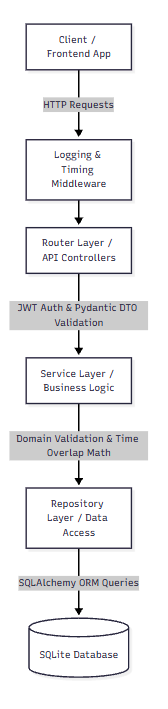
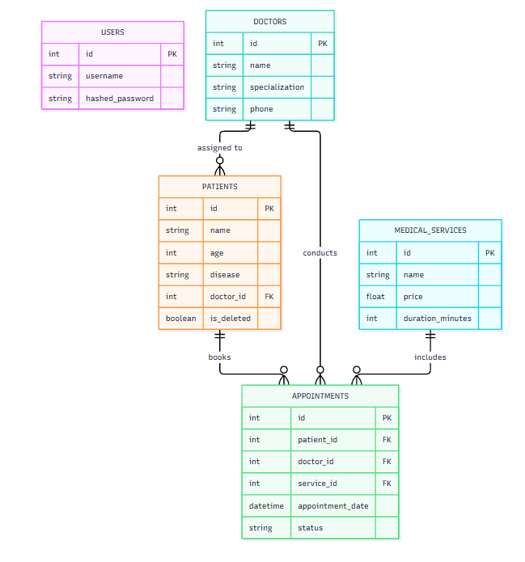
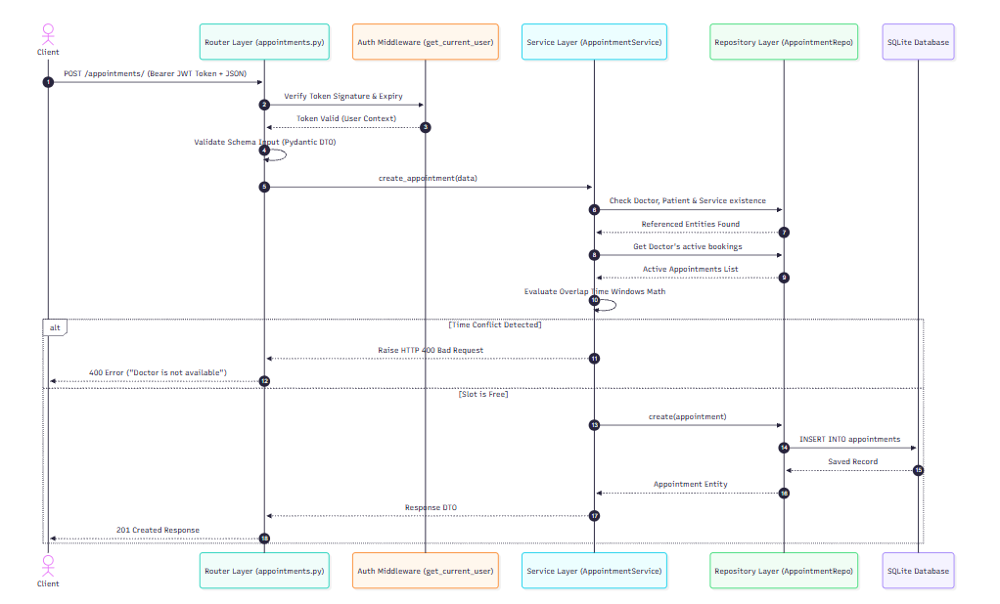

# Medical Hospital Management System API

An enterprise-grade Python Backend API built with **FastAPI** and **SQLAlchemy**, designed following a strict **3-Layer Architecture** (Routers, Services, Repositories) for scalable hospital administration, patient record management, and clinical analytics.

## Key Technologies

* **Framework:** FastAPI (Python 3.10+)

* **ORM & Database:** SQLAlchemy (SQLite)

* **Data Validation & DTOs:** Pydantic v2

* **Security & Authentication:** OAuth2 with JWT (`PyJWT`, `Passlib` with `Bcrypt`)

* **Testing & Quality Assurance:** Pytest, Pytest-Cov

* **Logging & Audit:** Custom FastAPI Middleware (`LoggingMiddleware`)

## System Architecture & Layering

The application enforces a strict separation of concerns to maximize maintainability, testability, and enterprise scalability:





### Layer Responsibilities

1. **Router Layer (`router/`)**: Handles HTTP endpoint registration, query/path parameters, JWT token extraction, and response serialisation.

2. **Service Layer (`services/`)**: Encapsulates core business rules (preventing doctor schedule conflicts, soft-deletion handling, medical status workflows, and revenue calculations).

3. **Repository Layer (`repositories/`)**: Manages raw database interactions via SQLAlchemy (CRUD operations, filtering, pagination, and SQL aggregations).

## Relational Schema (ERD)

The database schema manages relationship integrity across core healthcare entities:



## Request Lifecycle & Validation Flow

When booking an appointment, request data flows through multi-stage validation checks before persistence:



##  Core Modules & Business Features

* **Authentication & Authorization:** User registration, password hashing (`bcrypt`), and JWT Bearer Token validation.

* **Doctor Management:** Full CRUD operations for clinical staff and specializations.

* **Patient Management:** Full CRUD with **Soft Delete** support (`is_deleted=True`) to preserve clinical history, plus a dedicated history retrieval endpoint (`GET /patients/{id}/history`).

* **Medical Services Catalog:** Configurable procedures with pricing and duration (in minutes).

* **Appointment Management:**

  * Automated overlap conflict prevention per doctor based on procedure duration:
    
`requested_start < existing_end` **and** `requested_end > existing_start`

  * Status lifecycle management (`scheduled`, `completed`, `cancelled`).

  * Automatic time slot release upon appointment cancellation.

  * Search filtering (by doctor, patient, status) and pagination support (`skip`, `limit`).

* **Analytics & Reporting Module:** Aggregate stats for hospital metrics, completed vs. cancelled bookings, revenue by doctor, and revenue by medical service.

* **Audit & Middleware:** Custom HTTP request logging and performance duration header (`X-Process-Time`).

## Project Directory Structure

```
Medical_app/
├── repositories/           # Data Access Layer (SQLAlchemy ORM Queries)
│   ├── analytics_repository.py
│   ├── appointment_repository.py
│   ├── doctor_repository.py
│   ├── patient_repository.py
│   └── service_repository.py
├── services/               # Business Logic Layer (Domain Validations)
│   ├── analytics_service.py
│   ├── appointment_service.py
│   ├── doctor_service.py
│   ├── medical_service_service.py
│   └── patient_service.py
├── router/                 # API Controllers Layer (FastAPI Endpoints)
│   ├── analytics.py
│   ├── appointments.py
│   ├── auth.py
│   ├── doctors.py
│   ├── patients.py
│   └── services.py
├── tests/                  # Automated Test Suite (Pytest)
│   ├── test_analytics.py
│   ├── test_appointments.py
│   ├── test_doctors.py
│   ├── test_patients.py
│   └── test_services.py
├── database.py             # Database Engine & Session Local Setup
├── main.py                 # FastAPI Application Gateway & Router Registration
├── middleware.py           # Logging & Performance Middleware
├── model.py                # Database Relational Entities (SQLAlchemy Models)
├── schemas.py              # Data Transfer Objects (Pydantic Schemas)
└── requirements.txt        # Project Dependencies

```

## Installation & Local Setup

### 1. Clone Repository & Setup Virtual Environment

```
git clone <REPOSITORY_URL>
cd Medical_app
python -m venv venv
.\venv\Scripts\Activate.ps1

```

### 2. Install Dependencies

```
pip install -r requirements.txt

```

### 3. Run Development Server

```
uvicorn main:app --reload

```

The API server will run at `http://127.0.0.1:8000`.

Interactive Swagger documentation is available at `http://127.0.0.1:8000/docs`.

## Testing & Code Coverage

Run the automated test suite with Pytest:

```
python -m pytest

```

